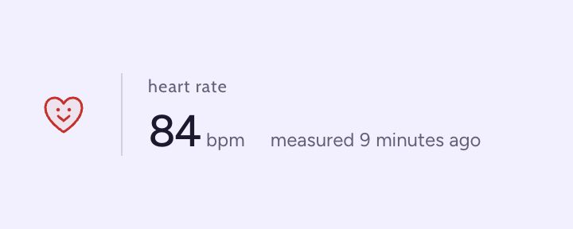

# pulse ♥

my heartbeat, on my website. a little widget for your latest heart rate + how long ago it was measured. made it for mine, figured you might want it for yours too :3

[see it on my website](https://laywu.ca/) · [make it yours](docs/QUICKSTART.md) · [MIT license](LICENSE)

## pick your size

**compact** — the little one I put beside my clock.


**full** — a little more room for the heart and the numbers.



example readings, not my current heart rate. both have transparent backgrounds and light/dark themes. the lavender is just for the previews.

## make it yours

fork, and tell ur agent to follow the [quick setup guide](docs/QUICKSTART.md). cloudflare is what I used, but I'm sure you can tell ur agent to use other hosting services too.

## put it on your website

once yours is running, swap in your host + feed and drop this wherever you want it:

```html
<iframe
  src="https://YOUR-PULSE-HOST/embed.html?feed=my-pulse&layout=compact&theme=light"
  title="Latest measured heart rate and measurement age"
  width="180"
  height="44"
  style="display:block;border:0"
  referrerpolicy="no-referrer"
></iframe>
```

| style | settings |
| --- | --- |
| compact | `layout=compact`, about 180 × 44px |
| full | omit `layout`, about 320 × 112px |
| theme | `theme=light` or `theme=dark`; omit it to follow the viewer’s device |

if your site has a theme toggle, have it update the iframe’s `theme` too. give it a bit more room on narrow layouts or with bigger text. old links with `source=cloud` still work.

## how fresh is it?

your device → google health → pulse → your website.

pulse checks google once a minute. each open widget checks the saved reading every five seconds; the age ticks on its own every second. your laptop can be off.

the catch: your phone and google have to sync first. sometimes that takes a while. the age is **when it was actually measured**, so a 20-minute-old reading says so. if the checks fail, the last reading stays up with “updates paused.” cute beating heart, yes. live heartbeat stream, no.

I've tested this with my fitbit. apple watch data through google health still needs testing, so no promises there yet.

## the private stuff

you use your own accounts and keys. you're hosting your own copy, not signing up for mine.

- **public:** your latest bpm, when it was measured, update status, and server time. anyone with the feed link can read those. connecting starts sharing.
- **private:** google tokens stay encrypted on the server. credentials + encryption keys live in cloudflare secrets. your owner key unlocks the controls; keep it out of git and your embed code.
- **done sharing?** disconnect on your owner page to clear the saved connection and reading. that doesn't revoke access in your google account or erase anything someone already saved.

google OAuth apps left in Testing generally need reconnecting after seven days. learned that one during setup. see the [production setup notes](docs/CLOUDFLARE.md#moving-a-personal-deployment-out-of-testing).

## working on it

will try to make this function more like whoop. pls help :3

```sh
npm ci
npm run typecheck
npm test
npm run build:cloud
npx wrangler deploy --dry-run
```

[contributing notes](CONTRIBUTING.md), if you want to help. there’s also a [local tester](docs/CLOUD_TEST.md) for figuring out sync delays. use the hosted setup for your actual website.

## license

[MIT](LICENSE) © Lei Wu. fork it, change it, put a little heart on your site. figtree + cabin keep their own SIL Open Font Licenses in `web/fonts/`.
